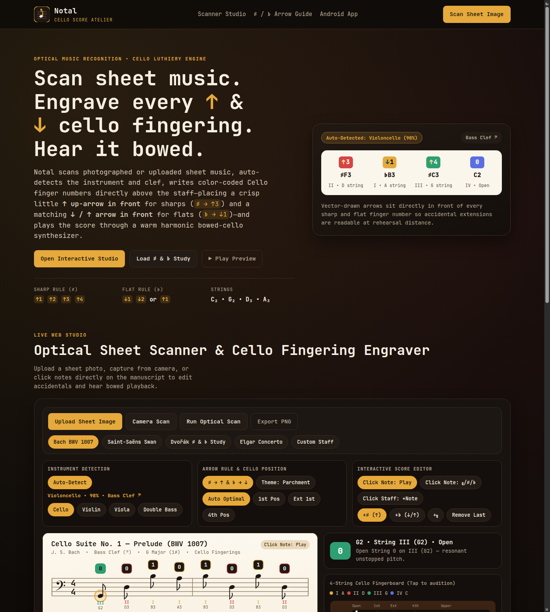
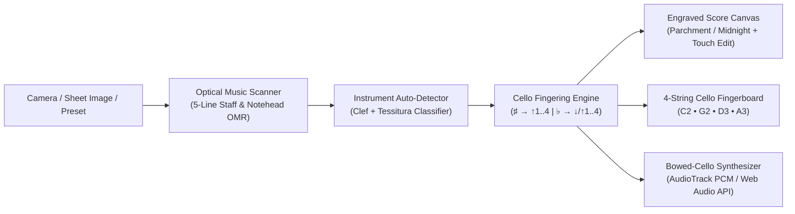

# Notal — Optical Music Sheet Scanner, Cello Fingering Engraver & Player

[](android/)
[](web/)
[](https://github.com/MateescuAdrian/notal/releases)
[](LICENSE)

**Notal** is a dual-platform music utility suite (Native Android App + Interactive Web Studio) designed with a bespoke *Luthier's Atelier & Illuminated Conservatory* aesthetic. It scans printed or photographed music sheets, auto-detects the instrument and clef, writes Cello finger numbers (`0–4`) directly onto the score with a crisp **little `↑` up-arrow in front for sharps (`#`)** and **`↓` (or toggleable `↑`) arrow in front for flats (`b`)**, and plays back the annotated music using a bowed-cello harmonic synthesizer.



---

## Key Features

- **Optical Music Recognition (OMR) Sheet Scanner**
  - **Android**: Scan via device camera (`TakePicturePreview`), import any sheet photo from gallery (`GetContent`), or run the built-in optical manuscript scanner with an animated scan laser and notehead bounding overlay.
  - **Web**: Drag-and-drop or upload sheet images, scan live with a webcam via `<dialog>` + `getUserMedia`, or test OMR staff-lock directly on synthesized manuscripts.
- **Instrument Auto-Detection & Override**
  - Evaluates clef (`𝄢` Bass, `𝄡` Tenor, `𝄞` Treble), score headers, and MIDI pitch tessitura to auto-detect **Cello (Violoncello)**, **Violin**, **Viola**, or **Double Bass** with confidence reasoning and 1-tap manual switching.
- **Cello Fingering & Accidental Arrow Grammar**
  - **Sharps (`♯`)**: Always displays a vector-drawn **`↑` up-arrow directly in front** of the finger number (`↑1`, `↑2`, `↑3`, `↑4`) to signal an upward half-step extension.
  - **Flats (`♭`)**: Displays **`↓` in front** (`↓1`, `↓2`, `↓3`, `↓4`) by default, with a 1-tap toggle to **`↑` in front** (`↑1..↑4`) for players who prefer uniform accidental arrows.
  - **Position Modes**: `Auto Optimal`, `1st Position`, `Extended 1st`, and `4th Position`.
  - **Interactive Score Editing**: Tap/click notes to audition or cycle `♮ / ♯ / ♭`, or tap staff lines to write new notes onto the sheet with instant fingering annotation.
- **Interactive 4-String Cello Fingerboard**
  - Synchronized ebony fingerboard (`I A3`, `II D3`, `III G2`, `IV C2`) with position markers (`Open`, `1st`, `Ext`, `4th`, `Upper`), live finger-stop indicators, and tap-to-audition strings.
- **Real-Time Bowed-Cello Audio Synthesizer**
  - **Android**: Multi-harmonic `AudioTrack` (`44.1 kHz` 16-bit PCM) synthesis with bow attack transient and `5.4 Hz` vibrato.
  - **Web**: `AudioContext` harmonic `PeriodicWave` + body formant `BiquadFilterNode` + vibrato LFO + optional metronome + tempo (`44–176 BPM`) and loop controls, plus **PNG export** of annotated scores.

---

## Cello String & Accidental Arrow Reference

| String | Open Pitch | Color Code | Natural / Open | Sharp (`♯`) Example | Flat (`♭`) Example |
| :--- | :---: | :--- | :---: | :---: | :---: |
| **I (A)** | `A3` | Gold (`#E5A93C`) | `0`, `1` (`B3`) | `↑1` (`A♯3`), `↑3` (`C♯4`) | `↓1` / `↑1` (`B♭3`), `↓4` / `↑4` (`E♭4`) |
| **II (D)** | `D3` | Crimson (`#D64545`) | `0`, `2` (`F3`) | `↑1` (`D♯3`), `↑3` (`F♯3`) | `↓1` / `↑1` (`E♭3`), `↓4` / `↑4` (`A♭3`) |
| **III (G)** | `G2` | Emerald (`#2E9F72`) | `0`, `4` (`C3`) | `↑1` (`G♯2`), `↑4` (`C♯3`) | `↓1` / `↑1` (`A♭2`), `↓2` / `↑2` (`B♭2`) |
| **IV (C)** | `C2` | Cobalt (`#5B6EE1`) | `0`, `3` (`E2`) | `↑1` (`C♯2`), `↑4` (`F♯2`) | `↓2` / `↑2` (`E♭2`), `↓4` / `↑4` (`G♭2`) |

---

## Architecture



---

## Repository Structure

```text
notal/
├── android/                               # Native Kotlin Android app (minSdk 26, targetSdk 35)
│   └── app/src/
│       ├── main/java/com/notal/atelier/
│       │   ├── MainActivity.kt            # Luthier Atelier UI, camera/gallery launchers, transport dock
│       │   ├── model/MusicModels.kt       # Instrument, Clef, Accidental, CelloString, SheetScore models
│       │   ├── engine/
│       │   │   ├── CelloFingeringEngine.kt    # Fingering, ↑/↓ arrows, auto-detect, presets
│       │   │   └── SheetMusicScannerEngine.kt # Bitmap luminance OMR scanner
│       │   ├── audio/CelloAudioSynthesizer.kt # 44.1 kHz AudioTrack bowed-cello synthesizer
│       │   └── ui/
│       │       ├── SheetScoreCanvasView.kt    # Interactive staff engraver + vector arrow badges
│       │       └── CelloFingerboardView.kt    # Interactive 4-string Cello fingerboard view
│       └── test/java/com/notal/atelier/
│           └── CelloFingeringEngineTest.kt    # Unit tests for ↑/↓ arrow & fingering rules
├── web/                                   # Zero-dependency Web Studio
│   ├── index.html
│   ├── styles.css
│   └── app.js
├── docs/preview-web-studio.png
├── .github/workflows/ci.yml
└── LICENSE
```

---

## Quickstart

### Android App

Download the ready-to-install APK from [GitHub Releases](https://github.com/MateescuAdrian/notal/releases), or build and install directly from source:

```bash
cd android
./gradlew testDebugUnitTest assembleDebug
./gradlew installDebug
```

*(Requires Android SDK Platform 35 and JDK 17+.)*

### Web Studio

Serve the `web/` directory with any static file server (no build step or `npm install` required):

```bash
python3 -m http.server 8080 --directory web
```

Then open [http://localhost:8080](http://localhost:8080) in your browser.
